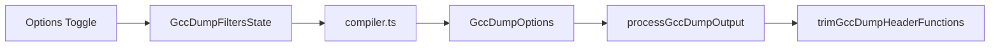
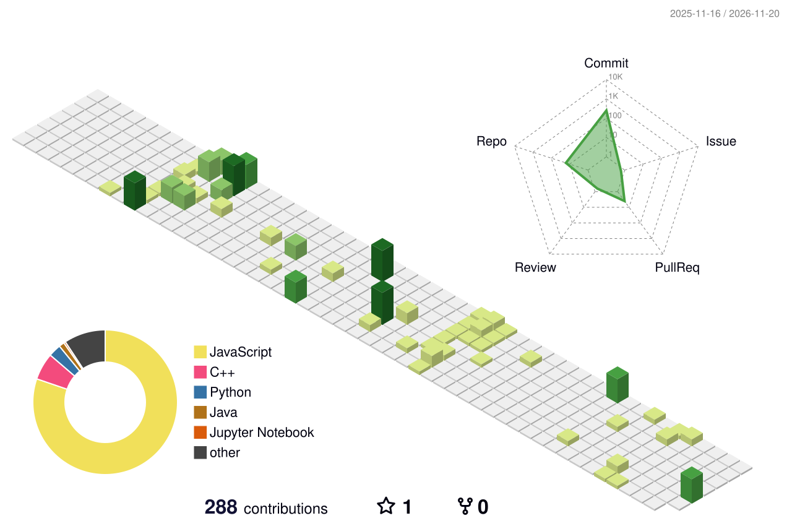

  
  

<i>Building scalable systems, reliable backend services, and production-ready applications.</i>

  
  

---

## 👨‍💻 About Me

I'm a final-year Computer Science Engineering student with hands-on experience building secure, reliable backend services in cloud-native, microservice-based environments. I enjoy designing scalable systems and turning complex workflows into production-ready applications.

---

## 💼 Experience

<table>
  <tr>
    <td>
      <h3>🚀 EVArc — SWE Intern</h3>
      
📍 Remote &nbsp;|&nbsp; 🗓 August 2025 – September 2025

      <ul>
        <li>Built backend features for <b>Wallet Services</b> using <b>Java, MongoDB, and AWS Lambda</b>, focusing on secure and reliable payment pipelines.</li>
        <li>Implemented <b>Ledger & Reconciliation</b> pipelines to ensure transaction accuracy, consistency, and automated reconciliation.</li>
        <li>Collaborated in a <b>6-member team</b> across distributed microservices, delivering end-to-end transaction workflows in a cloud-native architecture.</li>
      </ul>
    </td>
  </tr>
</table>

---

## 🌍 Open Source Contributions

  
  
  
  

<table>
  <tr>
    <td width="50%" valign="top">
      <h3>🐞 The Problem</h3>
      
The GCC dump pane silently deleted every function whose source path contained <code>/usr/</code>, <code>/opt/</code>, or <code>/include/</code>, making inlined standard-library and third-party functions impossible to inspect.

    </td>
    <td width="50%" valign="top">
      <h3>💡 The Solution</h3>
      
An opt-in <b>Library Functions</b> toggle in the Options dropdown. The filter stays on by default, so existing behavior is unchanged.

    </td>
  </tr>
</table>

### 🔌 End-to-End Wiring

### ✅ Quality Checks

  
  
  
  

  <a href="https://github.com/compiler-explorer/compiler-explorer/pull/9137"><b>View the Pull Request →</b></a>

---

## 🛠 Tech Stack

<table>
  <tr>
    <td width="220"><b>👨‍💻 Programming Languages</b></td>
    <td>
      
    </td>
  </tr>
  <tr>
    <td><b>🌐 Web Technologies</b></td>
    <td>
      
    </td>
  </tr>
  <tr>
    <td><b>🗄️ Databases</b></td>
    <td>
       
    </td>
  </tr>
  <tr>
    <td><b>🧰 Tools & Platforms</b></td>
    <td>
      
    </td>
  </tr>
  <tr>
    <td><b>🤖 AI/ML & GenAI</b></td>
    <td>
      
      
      
      
      
      
    </td>
  </tr>
  <tr>
    <td><b>📚 Fundamentals</b></td>
    <td>
      
      
      
      
      
      
    </td>
  </tr>
</table>

---

  

---

## 📊 GitHub Stats

  
  
   
  

---

## 📫 Let's Connect

  
  &nbsp;
  
    
  <i>Open to opportunities, collaborations, and conversations about backend and cloud engineering.</i>
    
  ⭐ <b>Thanks for stopping by!</b> ⭐

